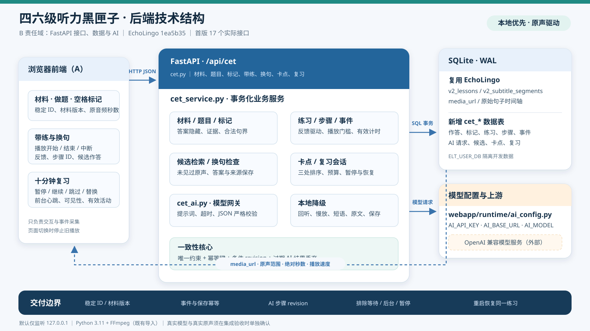

# CET 听力黑匣子后端交付记录

日期：2026-11-03。负责人范围：B（后端、数据与 AI）。

## 1. 固定版本与实现入口

- EchoLingo：`1ea5b3514691545174ed81466c6199e93a6f43ae`，与任务书静态检查版本一致。
- 旧项目参考：`ff055978efe723dbe07a788c9c6fba5bc2b30c6e`。
- CET 路由：`backend/webapp/fastapi_routes/cet.py`。
- 业务、迁移与持久化：`backend/webapp/services/cet_service.py`。
- 模型调用与格式校验：`backend/webapp/services/cet_ai.py`。
- 底座入口注册与启动迁移：`backend/fastapi_server.py`。
- 后端自测：`tests/test_cet_backend.py`。

材料直接复用 `v2_lessons`、`v2_subtitle_segments` 和既有 `media_url`，模型直接复用 `webapp/runtime/ai_config.py`。没有另建材料库或模型密钥配置。

### 技术结构图



可编辑矢量源文件为 `CET_BACKEND_ARCHITECTURE.svg`，可直接插入支持 SVG 的演示文稿。数据流为：浏览器交互与事件采集 → 17 个 CET HTTP 接口 → 事务化业务服务 → EchoLingo 既有材料/SQLite 与模型配置。底部列出幂等、版本、有效计时和重启恢复边界，外部模型与真实原声均需独立验收。

## 2. 实际接口清单（17 个）

服务前缀均为 `/api/cet`。创建与动作接口中的客户端 ID 是幂等键；请求中的 `stepId`、`materialVersion` 用于拒绝过期操作。

| 方法 | 路径 | 用途与关键请求字段 |
| --- | --- | --- |
| GET | `/materials` | 材料列表；可选 `level=cet4/cet6/unspecified`。 |
| GET | `/materials/{material_id}` | 材料、音频地址、来源、版本及句子时间轴。 |
| GET | `/materials/{material_id}/questions` | 读取题目；交卷前不返回答案、答案来源或证据。 |
| POST | `/attempts` | `attemptId/materialId/materialVersion/listeningSessionId/answers`；判题并保留首次提交。 |
| POST | `/marks` | `markId/listeningSessionId/materialId/materialVersion/rawSeconds`；可选 `speed/reactionDelaySeconds/suggestedSentenceId`。 |
| GET | `/marks?materialId=...&listeningSessionId=...` | 按材料及可选听音会话恢复标记。 |
| PATCH | `/marks/{mark_id}` | `confirmedSentenceId/materialVersion`；交卷后确认建议句或前后一句。 |
| POST | `/practices` | `practiceId/markId`；一个标记恢复同一个练习。 |
| GET | `/practices/{practice_id}` | 当前步骤、历史步骤、反馈来源、有效用时及最新 AI 请求状态。 |
| POST | `/practices/{practice_id}/events` | 播放、反馈、可见性、前台心跳和换句作答事件。 |
| POST | `/practices/{practice_id}/next` | `requestId/stepId/materialVersion`；可选 `action`，否则按最新反馈选择动作。 |
| POST | `/practices/{practice_id}/local` | `actionId/action/stepId/materialVersion`；本地 `replay/slow/chunk/explain`。 |
| POST | `/practices/{practice_id}/finish` | `finishId/stepId/materialVersion`；结束并幂等保存卡点。 |
| GET | `/review-items` | 卡点、最新反馈、优先级和待练状态。 |
| POST | `/reviews` | `reviewId`；可选 `budgetMs`（默认且最大 600000）、`itemIds`（最多三项）。 |
| GET | `/reviews/{review_id}` | 会话、条目、当前真实练习、预算和恢复状态。 |
| POST | `/reviews/{review_id}/actions` | `actionId/action/currentEntryId`；支持 `start/pause/resume/skip/replace/complete/finish`。 |

错误响应使用 HTTP 状态码及：

```json
{
  "detail": {
    "code": "STALE_RESPONSE",
    "message": "模型结果已过期，未覆盖当前练习。"
  }
}
```

### 事件字段与语义

公共字段：`eventId/type/stepId/materialVersion`。按类型增加：

- `playback_start/playback_end/playback_interrupt`：`audioTime/speed/activeMs/foreground`。
- `activity_heartbeat`：`activeMs` 为 1—5000，`foreground`；复习时附 `reviewId`。
- `visibility`：布尔 `visible`。
- `feedback`：`sound/meaning/heard`，来源保存为 `user`。
- `transfer_answer`：`answer`；完整播放换句原声后才接受，作答后才返回参考答案和来源。

非解释步骤必须先收到达到尾点和有效时长的 `playback_end`，才能提交反馈。重复 `eventId` 不重复累计时间；AI 等待、后台、暂停及预算耗尽后的用时为零。

### 动作决策

- 首个 `sound`：本地 0.75 倍 `slow`；再次 `sound`：AI `chunk`。
- `meaning`：AI `explain`。
- 辅助步骤后的 `heard`：隐字、原速、全句 `replay`。
- 隐字原速回听后的 `heard`：检索未见过的真实原声并进入 `transfer`；无候选返回带 `reason=no_candidate` 的 `finish` 步骤，仍可保存。
- 后续 `sound/meaning` 会覆盖早先 `heard`，最终结果保持 `blocked`。换句作答只算辅助辨认，不单独证明独立听懂。

## 3. 身份、版本、来源与数据表

- 材料 ID：`v2-{lesson_id}`；句子 ID：`v2-{lesson_id}-{segment_index}`。
- 材料版本：对音频 URL 和全部句子时间轴/文本计算 SHA-256 摘要，格式为 `sha256-...`。
- 练习保存材料版本、句子快照、音频 URL、当前步骤和递增 `revision`。
- 每次 AI 请求绑定 `requestId/practiceId/stepId/revision/action`；本地操作、反馈、结束、暂停和重启均会使旧请求失效。
- 标记分别保存原始按键秒数、按反应延迟修正的秒数、倍速、建议句和确认句。建议来源为 `estimated_alignment`。同一场听音 1.5 秒内标记合并。
- 换句候选来自真实 `v2_subtitle_segments` 和对应 `media_url`；排除已作答、已练习、已作候选及同源材料。
- 换句参考答案来源保存为 `ai:{model}:{requestId}`；作答前不出现在练习响应中。
- 文本估算的短语句界标记为 `estimated_alignment`，不冒充词级对齐。

新增表均为 `CREATE TABLE IF NOT EXISTS`：`cet_questions`、`cet_attempts`、`cet_attempt_answers`、`cet_marks`、`cet_practices`、`cet_practice_steps`、`cet_practice_events`、`cet_ai_requests`、`cet_transfer_candidates`、`cet_review_items`、`cet_reviews`、`cet_review_entries`、`cet_review_actions`。

启动时自动执行 `db.init_db()` 和 `cet_service.init_cet_schema()`。重启恢复规则：

- `pending` AI 请求标记为 `failed/SERVER_RESTARTED`，迟到结果只能转为 `stale`，不能写入当前步骤。
- `active` 复习转为 `paused` 并增加 `pauseCount`；练习 ID、当前步骤和有效用时保持不变。
- SQLite 使用既有 WAL、外键、唯一约束、事务和条件 revision 更新。

## 4. 配置、启动与备份

### 环境变量

| 变量 | 用途 | 默认 |
| --- | --- | --- |
| `AI_API_KEY` | 既有 OpenAI 兼容模型密钥，只从本地 `.env`/环境读取 | 空；未配置时 AI 返回 `AI_NOT_CONFIGURED`，本地动作仍可用 |
| `AI_BASE_URL` | 既有模型服务地址 | `https://api.deepseek.com` |
| `AI_MODEL` | 模型名 | `deepseek-chat` |
| `CET_AI_TIMEOUT_SECONDS` | CET 模型超时，限制 1—120 秒 | `25` |
| `ELT_USER_DB` | 独立开发数据库路径 | `resources/vocab.db` |
| `ELT_CONFIG_DIR` | 可变配置目录；`.env` 位于其下 | 项目根目录 |
| `ELT_HOST` | 监听地址 | `127.0.0.1`；仅显式设置 `0.0.0.0` 才开放局域网 |
| `ELT_PORT` | 服务端口 | `5173` |

完整底座按仓库 `requirements.txt` 安装后运行：

```powershell
python backend/fastapi_server.py
```

完整底座要求 **Python 3.11** 与 **FFmpeg**，首次安装完整依赖可能下载数 GB。FFmpeg 可加入 `PATH`，或用 `FFMPEG_PATH` 指向可执行文件。本次 CET 自测所用的最小 Python 依赖为 `fastapi`、`uvicorn[standard]`、`openai`、`httpx`、`pytest`。既有音视频导入/转写仍按底座要求准备 FFmpeg；CET 慢放通过原音频范围与 0.75 播放速度执行，不生成新的音频文件。

### 数据隔离与备份

每位开发者使用不同的 `ELT_USER_DB`，不要覆盖队长正式数据。迁移可在同一数据库重复执行。在线备份使用 SQLite Backup API，同时包含 WAL 中已提交数据：

```powershell
python -c "import sqlite3; source=sqlite3.connect('resources/vocab.db'); target=sqlite3.connect('resources/vocab-backup.db'); source.backup(target); target.close(); source.close()"
```

恢复前先停止服务并另行保留现有数据库。不要把 `.env`、密钥或开发数据库放进交付源码包。

## 5. 验证结果

### 自动化测试

命令：

```powershell
python -m pytest -q tests/test_cet_backend.py
```

结果：**12 passed**。覆盖：

- 材料、题目答案隐藏、判题、未知答案、首次提交保留。
- 标记反应延迟、1.5 秒长按合并、句界、前后句确认和刷新恢复。
- 播放门槛、两类反馈、慢放、隐字回听、最新失败反馈覆盖。
- AI 成功、超时、未配置、非法输出、无候选、本地回退。
- 真实候选引用、换句答案来源、作答前答案隐藏、重复保存。
- 三处复习、替换、跳过、暂停、有效计时、预算、重启恢复。
- 并发重复交卷/标记/事件、AI 等待不计时、切步骤及重启后的迟到模型结果。

### 真实 HTTP 请求

通过本机 `127.0.0.1:8765` 对实际 FastAPI 路由执行完整请求链，而非只调用服务函数：

- 1 份材料、5 句时间轴、4 道题；交卷得分 2、未知答案 1；重复交卷结果一致。
- 两处卡点完成带练并保存；一处走解释与换句，一处走本地慢放。
- 换句候选音频 URL 来自独立材料；参考答案来源为 `ai:fixture-coach:http-transfer`。
- 复习包含两处，暂停时事件计时为 0，恢复同一练习/步骤；1000 ms 心跳重复提交只累计一次；跳过项保持 `pending`。
- 实际停止并重启服务进程后，两处标记均恢复；进行中的复习转为 `paused`，`pauseCount=1`，练习 `http-full-practice-2` 和步骤 `d47496e2189d467f98ae62952d91d990` 均未改变。
- 最终代码编译检查通过；源码与交付记录未检出密钥，也未创建 `.env`。

### 模拟与真实验收的边界

- HTTP 中的 `fixture-coach` 是**本地 OpenAI 兼容模拟上游**，用于验证真实 SDK 请求、提示词、JSON 校验和来源保存；它不是外部真实模型输出。
- 本机当时未配置 `AI_API_KEY`，因此**外部真实模型调用尚未验收**。配置后应复验解释、分段、换句及超时，不得把上述模拟结果写成真实模型结果。
- HTTP 材料及 `/fixtures/*.mp3` 均为 `developmentFixture`，用于接口和时间轴测试；**未进行真实音频播放、Range、FFmpeg 导入或内容答案核对**。
- 候选检索当前为英文词面重合排序；短语时间范围是文本估算。生产演示前需由 C 核对候选、答案、原声和来源。
- 本次未执行前端验收、底座全量页面回归、另一台电脑启动或 C 的缺陷复验；这些仍按任务书由对应负责人完成。

## 6. 参考材料与许可证

### 已补齐并核对的材料

| 材料 | 固定来源 / 本地位置 | 核对结果 |
| --- | --- | --- |
| EchoLingo 启动与功能说明 | `1ea5b35` / `README.zh-CN.md` | 确认 Python 3.11、FFmpeg、`FFMPEG_PATH`、`/api/docs`、无 Key 的本地能力和完整依赖安装边界。 |
| EchoLingo 许可证 | `1ea5b35` / `LICENSE` | PolyForm Noncommercial 1.0.0；保留 `Required Notice: Copyright 2026 shine11224`。 |
| 第三方组件许可 | `1ea5b35` / `THIRD_PARTY_LICENSES.md` | 第三方依赖、模型、词典、在线服务和素材分别遵循各自条款。 |
| llama.cpp 许可 | `1ea5b35` / `licenses/LLAMA_CPP_LICENSE.txt` | MIT，保留版权与许可全文。 |
| 旧项目许可证与素材声明 | `ff05597` / `../listening-sentence-index/LICENSE` | MIT；交付包副本为 `licenses/LISTENING_SENTENCE_INDEX_LICENSE.txt`。声明不附带真题音频和原文，使用者须确认合法素材来源及传播授权。 |
| 旧项目标记与听音 UI | `ff05597` / `desktop/src/blackbox-ui.mjs` | 核对播放/暂停/倍速/结束事件、标记串行保存和交卷前等待标记队列。 |
| 旧项目回听 UI | `ff05597` / `desktop/src/relisten-ui.mjs` | 核对选中句必须绑定到标记、练习中禁止换句和原文暴露语义。 |
| 旧项目带练 UI | `ff05597` / `desktop/src/practice-ui.mjs` | 核对播放中断、完成容差、反馈、换句作答、本地降级和重复学习事件。 |
| 旧项目复习 UI | `ff05597` / `desktop/src/study-ui.mjs` | 核对暂停恢复、跳过、替换、预算耗尽及按原练习恢复。 |

旧项目的业务模块 `blackbox.mjs`、`relisten.mjs`、`practice.mjs`、`fast-coach.mjs`、`coach.mjs`、`exam.mjs`、`study-session.mjs`、`store.mjs`、`main.mjs` 及四个回归测试已在首轮实现时参考。

### 上游待补材料

任务书列出的以下两份文件在旧项目固定提交 `ff05597` 的递归 Git 树中不存在，GitHub Contents API 也返回 404：

- `docs/体验审计/2026-10-29-AI带练功能链.md`
- `docs/体验审计/2026-10-29-十分钟复习与等待优化.md`

按任务书“远端缺失时记录待补”的要求，此处只登记缺口，不创建伪造替代文档。若队长本机有原件，应补入旧项目相同路径后再核对历史体验结论。

### 对联调的影响

- 底座默认监听 `0.0.0.0`；本改造版按任务书安全要求改为默认 `127.0.0.1`，需要局域网体验时必须显式配置并由 C 核对访问范围。
- 旧 UI 的 `play/resume/pause/seek/ended` 应映射到当前 `playback_start/playback_interrupt/playback_end` 等事件；当前接口以 `eventId` 幂等，旧 `playId` 可由前端映射为开始事件 ID。
- 旧 `captureId` 只表示待保存标记；当前后端需要稳定 `markId`，A 应在入队时生成并在确认后一直使用服务端返回的 ID。
- 旧换句 UI 支持 `unsure`；当前 CET 接口只接受实际选项 ID。若首版需要“不确定”，A、B、C 应先同步契约再实现，不能由前端静默当作错误答案。
- 当前复习 `replace` 由后端按优先级选择替换项；旧 UI 的 `itemId/replacementId` 若需保留，应在联调时增加显式映射。
- 原声播放使用后端返回的范围和速度；旧 UI 的尾点容差落在当前后端验证窗口内。离开、停止和切换步骤仍需上报中断，不能直接丢弃旧播放事件。

### 许可证与素材边界

分发改造版时须同时保留 EchoLingo 的 `LICENSE`、其中的 Required Notice、`THIRD_PARTY_LICENSES.md` 及适用的第三方许可。旧项目参考代码分发的许可副本放在 `licenses/LISTENING_SENTENCE_INDEX_LICENSE.txt`。PolyForm 的非商业限制、参赛适用性和公开传播条件由团队与 C 在正式提交前确认，本记录不作法律判断。真实真题音频、原文和换句材料必须另行确认合法来源，不因接口使用开发夹具而自动获得分发权。
