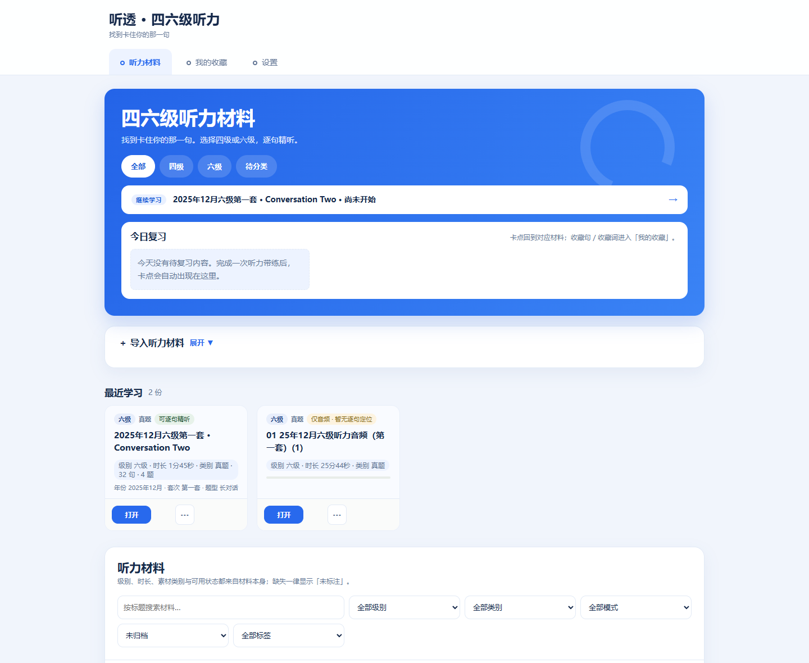
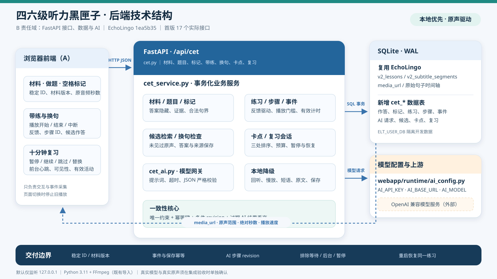

# 听透 · 四六级听力

> **找到卡住你的那一句。**

四六级听力真题音频切成一句一句，你只需要标出「哪一句没听懂」，剩下的时间就花在那句上——盲听、对答案、找到卡点、反复精练，直到听懂为止。



---

## 1. 演示视频

🎬 **演示视频：**（提交前补入比赛平台链接）

---

## 2. 核心功能（一条闭环）

1. **选级与材料库** — 四级 / 六级 / 待分类分栏，标题搜索，按真实学习进度恢复上次位置。
2. **导入本地音频** — 音频 + 可选 SRT/JSON 时间轴 + 可选纯文本原文；按 SHA-256 + 标题去重，仅音频也能整段播放（此时明确显示「暂无逐句定位」，不伪造时间戳）。
3. **盲听做题** — 不看原文、不泄露候选句先做一遍题，做题过程与音频位置都记录在案。
4. **对答案·找卡点** — 交卷后逐句核对，听到没听清的地方点「🚩 没听清」，系统据此给出候选句，由你确认「卡点」。
5. **精练·复习** — 对确认的卡点做换句检验（换个句子还听不听得出来）与 AI 带练讲解，逐句过关。
6. **今日复习** — 卡点、收藏句、收藏词三组入口，把当天没听懂的东西集中再过一遍。

---

## 3. 快速启动（macOS / Linux）

**环境要求：** Python **3.11**、**FFmpeg（需 `ffmpeg` 与 `ffprobe` 都在 PATH 上）**。
`requirements.txt` 含 `faster-whisper` 等依赖，**第一次安装会下载较多内容（数百 MB 级），请预留时间**。

```bash
git clone https://github.com/yb-beep/EchoLingo.git && cd EchoLingo
git checkout v1.0-demo
python3.11 -m venv .venv && .venv/bin/pip install -r requirements.txt
cp .env.example .env    # 填 AI_API_KEY；不填也能运行，AI 部分走离线兜底
PORT=5380 scripts/cet/run.sh --fresh --data-dir /tmp/tingtou
```

启动后浏览器打开：**<http://127.0.0.1:5380/>**

- `run.sh` 会先做环境检查（Python / FFmpeg / 端口 / 数据目录），再启动服务并打印真实材料链接；
- `--fresh` 表示使用全新空库（演示干净状态），`--data-dir` 指定数据目录，**不会碰到仓库里的正式库**；
- 换端口就改 `PORT`；只检查不启动用 `scripts/cet/run.sh --check`（纯只读，不建目录、不写库）；
- 导入材料或启动脚本遇到问题时，`scripts/cet/run.sh --check` 的第一段「运行环境」会直接指出缺什么。

> **Windows 说明**：同一套源码可在 Windows 运行（本项目即在此复核），但 `run.sh` 走的是 POSIX shell，
> 需要 Git Bash 或 WSL；Windows 下也可直接 `python -m uvicorn` 起 `backend/fastapi_server.py`。

---

## 4. 导入听力材料

**真题音频受版权保护，不随仓库分发。** 仓库只带导入脚本与格式约定，音频与时间轴请自行准备。

素材目录（默认 `.cet-qa/media/`）：

| 文件 | 必需 | 说明 |
| --- | --- | --- |
| `<materialId>.mp3` | ✅ | 音频原件（`.mp3` `.m4a` `.wav` `.aac` `.flac`） |
| `<materialId>.sentences.source.json` | 可选 | 逐句时间轴；没有则整段播放 |
| `tests/fixtures/cet/source/<materialId>.questions.json` | 可选 | 选择题与答案 |

时间轴格式（节选，字段与 `scripts/cet/import_materials.py` 一致）：

```json
{
  "materialId": "cet6-202512-conv2",
  "materialVersion": "v1",
  "title": "2025年12月六级第一套 · Conversation Two",
  "level": "cet6",
  "section": "Conversation Two",
  "durationSec": 105.486,
  "sentences": [
    { "sentenceId": "s01", "index": 1, "startSec": 0.01, "endSec": 3.2, "text": "..." }
  ]
}
```

导入命令（**先让服务跑起来，再导**——`--fresh` 会重建空库，顺序反了材料会被清掉）：

```bash
# 导入登记表里的样例材料
.venv/bin/python scripts/cet/import_materials.py --all

# 或导入任意本地音频（可同时给 SRT）
.venv/bin/python scripts/cet/import_materials.py \
  --audio ~/Downloads/listening.mp3 \
  --title "2024年6月四级第一套 · News 1" \
  --level cet4 --category 练习 \
  --subtitle ~/Downloads/listening.srt
```

导完刷新首页即可看到材料；也可以在页面「导入听力材料」里直接上传（音频 + 可选字幕/文本）。

---

## 5. AI 配置

在 `.env` 中配置，任意 **OpenAI 兼容**的 Chat Completions 服务都可用：

| 变量 | 作用 | 示例 |
| --- | --- | --- |
| `AI_API_KEY` | 接口密钥；**留空则 AI 功能不可用，但听力主线照常运行** | `sk-...` |
| `AI_BASE_URL` | 接口地址（OpenAI 兼容） | `https://api.deepseek.com` |
| `AI_MODEL` | 模型名 | `deepseek-v4-flash` |

`.env.example` 里另有 Kimi、通义千问的预设可参照。密钥只放本地 `.env`，**不写进任何被提交的文件**。

---

## 6. 技术架构



- **前端**：Jinja2 模板 + 原生 JS，按「材料 → 做题 → 标记 → 带练 → 复习」组织交互，只负责交互与事件采集；
- **接口层**：FastAPI，`/api/cet/*` 提供材料、题目、标记、带练、换句、卡点、复习等接口；
- **业务层**：`cet_service.py` 事务化处理题目与标记（答案隐藏、证据句、合法句界）、练习状态与有效计时、卡点排序与复习预算；
- **AI 网关**：`cet_ai.py` 统一提示词、超时与 JSON 严格校验，异常时降级为本地策略（回听、慢放、原文、保存），**没有 key 也不会卡住主线**；
- **数据**：本地 SQLite，音频与时间轴按材料版本与 SHA-256 管理，默认全部离线。

---

## 7. 开源声明

本项目基于 **[shine11224/EchoLingo](https://github.com/shine11224/EchoLingo)** 二次开发，
沿用其 **PolyForm Noncommercial 1.0.0** 许可证，**保留上游 `LICENSE`、`THIRD_PARTY_LICENSES.md` 与 `licenses/` 目录的全部版权与署名信息**。
新增代码同样遵循该许可：个人、教育与非营利用途免费，商用需另行取得授权。

| 上游原有（EchoLingo） | 我们新做的（听透） |
| --- | --- |
| 通用英语精学底座：视频/播客/文章/PDF 多源导入 | 四六级听力模式：集中式功能收束与 `ELT_CET_MODE` 开关 |
| 逐句精读、阅读与写作练习 | 听力材料库：四级/六级/待分类、搜索、进度恢复、继续学习 |
| 词表高亮、离线词典、生词本 | 本地音频导入：音频 + SRT/JSON/文本，SHA-256 去重 |
| AI 对话、记忆故事、复述评分 | 听力工作区三步闭环：盲听做题 → 对答案·找卡点 → 精练·复习 |
| 多平台打包、积分与账号体系 | 卡点标记与候选句、换句检验、AI 带练（可离线兜底） |
| — | 今日复习（卡点 / 收藏句 / 收藏词） |
| — | 「听透」视觉层与手机端适配（375 宽可用） |
| — | 交付脚本：检查/修改分离、空库启动、数据隔离 |

---

## 8. 测试

```bash
ELT_CONFIG_DIR=/tmp/tingtou/config \
  .venv/bin/python -m pytest -q --ignore=tests/test_cet_listening_ui.py --ignore=tests/test_cet_contract.py
```

| 平台 | 结果 |
| --- | --- |
| macOS（Apple Silicon，交付机） | **1071 passed** ／ 2 failed（已知：`test_baidu_pan`、`test_health_planning_enabled`） |
| Windows 11（提交前复核） | 1051 passed ／ 105 skipped ／ 2 failed（同上两项；跳过项为平台相关） |

> 跑 pytest 时**不要设 `ELT_USER_DB`**：它的优先级高于测试内的 `DB_PATH` 覆盖，会让用例互相污染、产生大量假失败。

另外提供两项自验脚本：

```bash
.venv/bin/python scripts/cet/verify_base.py --port 5380   # 逐项自验（自起服务、自建空库、跑完自停）
.venv/bin/python scripts/cet/lead_trial.py --base http://127.0.0.1:5380   # 用户视角完整链路
```

---

## 9. 文档与致队友

- 启动/排错细节：[docs/cet-base/使用与启动.md](docs/cet-base/使用与启动.md)
- 功能收束与取舍理由：[docs/cet-base/功能收束清单.md](docs/cet-base/功能收束清单.md)
- 底座阶段的交接说明（旧版 README 全文存档）：[docs/cet-base/底座交付归档-旧版README-2026-11-06.md](docs/cet-base/底座交付归档-旧版README-2026-11-06.md)
- 上游通用版说明：[README.md](README.md) ／ [README.zh-CN.md](README.zh-CN.md)
