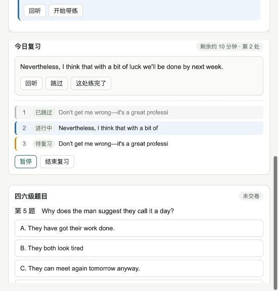

# ee6c5e2 独立验收与返修

日期：2026-11-05。结论：**不通过，需要返修；不能认定 M0–M4 全部完成。**

候选：`codex/cet-listening`，本地完整 SHA `ee6c5e230603bb7fedad003641e6e8ddcab6304f`。开始验收时工作区干净，origin 为 `https://github.com/yb-beep/EchoLingo.git`。本轮核实本地提交，未独立核验远端推送状态。

本次只验收、记录问题，不修改产品代码，不替执行者修复。验收后新增本报告及 evidence 文件，不提交或推送。

## 验收方式与边界

- 读取施工计划、CONTRIBUTING.md、交付包、前后端实现与测试。
- 将 `.cet-qa/data/vocab.db` 用 SQLite backup 复制到 `/tmp/cet-ee6c5e2-audit/vocab.db`。所有手动测试与接口契约测试使用该副本，不在原库写入测试答案或练习。
- 在 `127.0.0.1:5187` 启动同一提交的真实 FastAPI 路由与原前端、原音频文件。验收 harness 显式指定隔离 DB 和空模型配置，关闭启动后台任务的 lifespan，避免翻译等后台任务读写原数据。因此本次页面和 API 验收不等价于 `run.sh` 从零启动验收。
- 使用实际浏览器操作选题、交卷、空格标记、确认、带练、慢放、缺 key 解释、刷新、复习回听、跳过与暂停恢复。
- 无真实模型调用，未修改任何用户密钥或模型设置。H1 人工试听和第二台电脑验收未完成。播放界面正常不代表人耳核对准确。
- 没有重跑交付者那组固定访问 5173 的 21 项 UI 测试，以免污染正在运行的验收原库；改用隔离服务的真实 UI 操作复现。

## 本轮实测结果

| 检查 | 结果 | 证据 |
| --- | --- | --- |
| 后端单测、natural_tts、elt_credits 套件 | 21 passed，1 skipped | [日志](./evidence/ee6c5e2-independent/unit-results.txt) |
| 契约套件显式连接真实服务 5187 | 5 passed，3 failed，3 skipped；`--maxfail=3` 主动停止，余项未跑 | [日志](./evidence/ee6c5e2-independent/contract-real.txt) |
| 空格标记、交卷后确认、慢放与缺 key 降级 | 可操作，存在下列正确性缺陷 | 本报告 F01–F08 |
| 复习回听、暂停后继续、交卷与带练恢复 | 不通过 | [页面文本](./evidence/ee6c5e2-independent/paused-review.txt)、[截图](./evidence/ee6c5e2-independent/review-no-resume.png) |

实际测试命令：

```bash
ELT_CONFIG_DIR=/tmp/cet-ee6c5e2-audit/config \
ELT_USER_DB=/tmp/cet-ee6c5e2-audit/unit.db \
.venv/bin/python -m pytest tests/test_cet_backend.py tests/test_natural_tts.py tests/test_elt_credits_public_contract.py -q

CET_API_BASE=http://127.0.0.1:5187 \
.venv/bin/python -m pytest tests/test_cet_contract.py -q --maxfail=3
```

## 必须返修的问题

### F01 · P1 · 即使模型成功返回，前端也不展示解释正文

证据类型：代码检查；真实模型成功分支尚未运行。

- `frontend/static/cet-listening.js:491–577` 等待 `/next` 返回后，遇到 explain 只调用 `showExplainPending()`。
- `showExplainPending()` 不读取 `currentStep.data.explanation`，不发后续请求，只设定三秒计时器，固定改成“模型暂不可用”。
- 后端 `cet_service.py:891–905` 已把生成正文放在 `currentStep.data`。
- 所以这不是单纯缺 key：正常响应也会被前端丢掉。三秒等待提示也在请求结束后才启动，无法反映真正的模型等待。
- `sendFeedback()` 返回后直接合并到全局 `S.practice`，未验证当前练习身份。旧练习响应到达时可覆盖新练习；后端对单练习做 revision 校验不能保护前端跨练习切换。

修复标准：请求一开始显示等待；成功渲染后端正文，失败才显示错误；切卡点或结束后过滤迟到结果；用可控成功、超时、无效输出、跨练习延迟响应验证，再补真实模型测试。无需先提供 key 才修这些代码。

### F02 · P1 · 复习回听无效，暂停后缺少继续入口

证据类型：真实 UI + 代码 + 隔离数据库。

- `cet-listening.js:663–671` 读取 `startSecondsonds/endSecondsonds`，而数据字段为 `startSeconds/endSeconds`。实点“今日复习 → 回听”，播放器仍停在开头。
- 修正拼写时还要支持起点为 0，不能用 `!startSeconds` 排除合法零秒。
- 此处仅使用当前页面的播放器，没有按复习条目的材料切换音频。复习可能跨课程，不能只修字段后就认定回听正确。
- `cet-listening.js:702–710` 始终只渲染“暂停”和“结束复习”，没有 resume 操作。实点暂停后刷新，DB 状态为 `paused`，UI 仍显示“进行中”和“暂停”。
- 当前前端没有回报播放、前台活动等计时事件，十分钟计时不能据此宣称完整实现。

修复标准：回听实际条目的音频和范围；暂停显示已暂停、可继续同一会话；开始播放、跳过、完成、结束及时停止或清理旧回放；有效练习用时增长，暂停、后台和 AI 等待不增长。

### F03 · P1 · 刷新仅恢复部分标记，未恢复交卷和带练

证据类型：真实 UI + 代码。

复现：选一题交卷 → 确认卡点 → 开始带练 → 没听清 → 刷新。卡点还在，但右侧回到“未交卷”，带练面板消失。

- `cet-listening.js:734–771` 保存了 attemptId、practiceId，却没有在 restore 中读取对应作答和练习，只有 marks/review 恢复。
- 全部 ID 在 sessionStorage 中，正常关闭后重新进入不能保证找回。把清会话后看不到历史定义为设计行为，不符合保存后重开的要求。
- `markState()` 仅依据单个内存中的 `S.practice` 判断“本轮已练”，刷新或切练习会让已完成标记退回待练。

修复标准：从持久化记录恢复作答、练习 ID、当前步骤、反馈和完成状态。分别验刷新、关标签重开、服务重启；不可只验证面板出现。保留真实历史入口，不将测试清理作为用户丢记录的理由。

### F04 · P1 · 用户反馈未进入训练记录，智能体循环未接通

证据类型：真实 UI + 数据库 + 代码。

本轮创建 `practice-cb03bc94c82e`，点击“没听清”并慢放，再点“不懂意思”。记录为 `latest_feedback=null`、`effective_ms=0`，事件只有一次 `local_action: slow`，详见 [事件证据](./evidence/ee6c5e2-independent/feedback-events.json)。

- 前端只调 `/next`，从不发送 `/events`。
- `cet_service.py:1226–1235` 使用请求 feedback 选择固定动作，却未保存反馈；`local_practice_action()` 只记动作。
- AI 请求读取 DB 中 `latest_feedback`，实际可能一直为空。固定的三选一按钮不足以证明反馈驱动的训练已经完成。

修复标准：反馈先合法、幂等地记录到当前步骤，再据最新反馈选动作；播放事件和反馈在真实页面接入；连续操作后从 API/DB 核查 feedbackHistory、latestFeedback、步骤与有效时间一致，不能用改文案代替持久化。

### F05 · P1 · 换句与隐藏文字原速回听仍未接通

证据类型：交付者已承认 + 代码 + 可见 UI。

- 前端识别 transfer 标签，但没有渲染候选题、候选音频、答题和提交检验。
- `executeLocalAction()` 即使收到 `showText=false` 也只显示一句提示，未切换字幕或隐藏其他泄露原文的区域。
- 首次做题时默认显示英文字幕和含原文的内容大纲；进入标记模式没有隐藏。原 UI 可以保留，但训练模式的提示控制必须接入。
- “听懂了”直接映射 transfer，缺少可验证的隐藏提示、恢复原速再听这一步。

修复标准：完整显示和执行换句检验；没有候选明确待检验，不假成功。做题或独立回听时确实隐藏正文与答案，恢复原速；完成情况区分提示辅助和独立检验。补材料来源和答案依据检查。

### F06 · P1 · 未作答题被显示成选了 A

证据类型：真实 UI + 代码。

复现：仅选第 5 题 B 后交卷，第 6、7、8、9 题均显示“你选 A”。

根因在 `cet_service.py:586–592`。未作答得到空字符串，Python 的 `'' in 'ABCDE'` 为 True，`.index('')` 为 0。

修复标准：空值明确返回 choice=null，显示“未作答”；未知参考答案仍不判定正误。补部分提交、全部未答、非法选项及重复交卷的实际断言。

### F07 · P1 · 80 项契约通过不能作为真实服务验收证据

证据类型：实跑测试 + 测试配置。

- `tests/test_cet_contract.py:40` 默认 `http://127.0.0.1:5199`，交付包命令没设置 `CET_API_BASE`。
- `scripts/cet/run.sh:133` 还会主动启动 mock。交付包“未使用 mock”无法由这些命令支持。
- 本轮显式改连真实服务后，首三个失败分别是：材料详情缺约定外层 material；错误 version 返回 200；题目返回缺测试约定的 items。
- 原 UI 测试有 `assert ... or True`，暂停恢复测试仅断言面板和行存在，没有验证相同 ID、状态、回听或恢复操作。这解释了通过测试却仍断路的现象。

修复标准：先统一真实 API、适配层与文档的最终契约；分别运行真实服务和 mock 测试，输出地址与模式。UI 测试允许配置隔离地址，去掉永真断言，补本报告中的复现用例。不能通过删除真实断言凑绿。

### F08 · P2 · H1 提到的 2.5 秒回溯实际未生效，前后句调整会直接确认

证据类型：代码检查。

- 前端 `CFG.lookbackSec` 声明为 2.5，但后续未使用，创建标记也没有发 reactionDelaySeconds 或实际 playbackRate。
- 后端 `create_mark()` 默认 reactionDelaySeconds=0.6、speed=1。调前端的 2.5 无法改变候选定位。
- `adjustMark()` 在 `cet-listening.js:333–339` 直接调用 confirmMark。点击“前一句”就确认了句子，之后调整按钮消失，难以继续试前后句。
- 彩色状态目前在标记列表，不是音频时间线。不要在交付说明里把列表状态称作已完成时间线标记。

修复标准：确定单一回溯参数来源并传实际倍速；先预览候选，用户点“确认这句”后才确认，确认后仍能纠正；再做 H1 主观试听调参。保留真实按键时间。时间线标记单独实现或明确未做。

### F09 · P2 · 一键启动和新环境交付尚不能验收通过

证据类型：代码检查，未执行真实全新安装。

- `run.sh:141–142` 固定打印 2181/2182，但导入脚本使用数据库自增 lesson_id，新库并不保证这些 ID。页面测试同样硬编码现有库 ID。
- 启动脚本仅凭 `/health` 200 就复用已有服务，不核实仓库、提交与数据目录；可能展示另一版本或另一数据库。
- `backend/fastapi_server.py:87` 的后台恢复使用 `db.DB_PATH`，忽略 `ELT_USER_DB`。这属于底座遗留风险，但交付包承诺“不读写正式数据”前仍需隔离验证。本轮为避开该路径关闭 lifespan，因此不授予启动隔离通过。

修复标准：空隔离库重建时打印真实 ID；核实已有服务身份；审查和隔离所有启动任务；在清洁数据目录跑完整启动/停止。不能用当前机器已有数据库替代从零交付验证。

### F10 · P2 · 材料与完成状态说明需要纠正

证据类型：材料登记、API 与交付文档检查。

- 四级样例是 Let's Learn English 的 hope/wish 内容，名称已写样例，可以作为开发素材；不能在验收包统一声称“真实四级真题”。补真实四级来源前，记录为难度样例，难度判断也需有依据。
- 两份材料 API 的 audioSha256 均为空；原文时间轴的校准来源和 H1 待验证状态必须保留。
- 故意无答案的占位题适合故障用例，默认 Demo 应与真实题目分开呈现。
- 原验收包 T01–T17 表实际为 9 项自测通过、5 项部分、3 项未做/未测；交接消息的 11+4+3 不等于 17。
- M2 的换句与 M3 的当前卡点关联属于计划内容，不能在未变更范围的情况下写成“超出本轮范围”并同时宣布全部完成。

## T01–T17 的本轮结论

| 编号 | 结论 | 说明 |
| --- | --- | --- |
| T01 | 部分验证 | 原页面可打开、基础播放可操作；完整启动隔离未验证 |
| T02 | 未验证完整项 | 未执行缺时间轴与重复导入全矩阵 |
| T03 | 不通过 | 未作答题显示 A，刷新不恢复交卷结果 |
| T04 | 部分验证 | 实操空格可标记且继续播放；全键盘边界未重跑 |
| T05 | 不通过 | 回溯参数断接，候选调整直接确认；H1 未完成 |
| T06 | 不通过 | 动作切换可见，反馈未入记录，解释正文未接 |
| T07 | 未验证完整项 | 代码存在跨练习响应覆盖风险；未做真实 AI 慢响应 |
| T08 | 部分验证 | 缺 key 降级可见，超时、错误输出和恢复尚未完整验证 |
| T09 | 不通过 | 换句前端未接 |
| T10 | 部分验证 | 未知答案不判对错可见，无候选与失效材料未完成闭环 |
| T11 | 不通过 | 复习回听失效、暂停缺继续入口、带练恢复缺失 |
| T12 | 部分验证 | 跳过标签未算完成；完整训练结果语义尚未通过 |
| T13 | 未验证完整项 | 原结构保留，未将 HTTP 200 等同词汇等全流程通过 |
| T14 | 未验证 | 没有迁移旧库与回滚实测 |
| T15 | 部分验证 | 无 key 可用本地功能；真实模型、完整时延和日志检查待做 |
| T16 | 未验证完整项 | 未独立重跑全部尺寸和反复切换场景 |
| T17 | 未验证 | 第二台电脑未测，从零启动仍需 F09 修复 |

## 执行智能体的下一轮任务

先做一版修复 F02、F03、F04、F06，让回听、作答、反馈和恢复可靠；再接 F01、F05 的解释、隐藏原文、原速回听和换句。随后修正 F07–F10 的测试、定位、启动与文案。

继续沿用原前端，不要求改版。无 key 期间先用明确标记的成功/失败响应 fixture 验证渲染和状态隔离，不能把 fixture 当真实模型。当前不需要让用户先填 key 才修复代码缺陷。

每次返修提供新 SHA、受影响文件、最短复现与修复后的证据；测试服务地址和数据目录必须明确。不要自动发布、推送本报告或宣称听力效果提升。

H1 试听在回溯参数与回放范围修好后再进行；真实模型与第二台电脑列为独立待验事项。M1–M4 按实际范围重新标记为部分完成/待验收。

下图为暂停后刷新的实际界面。数据库仍为 paused，但界面仍写进行中、只提供暂停；同页交卷状态也回到未交卷。


