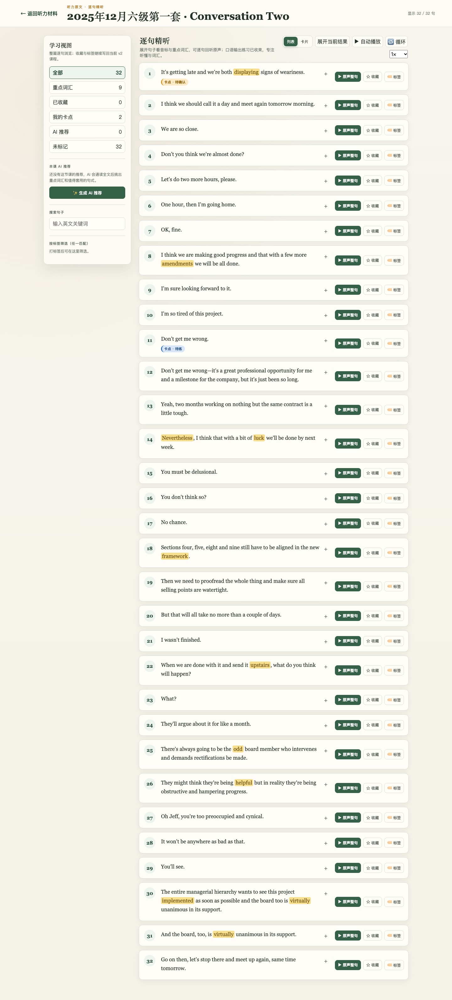
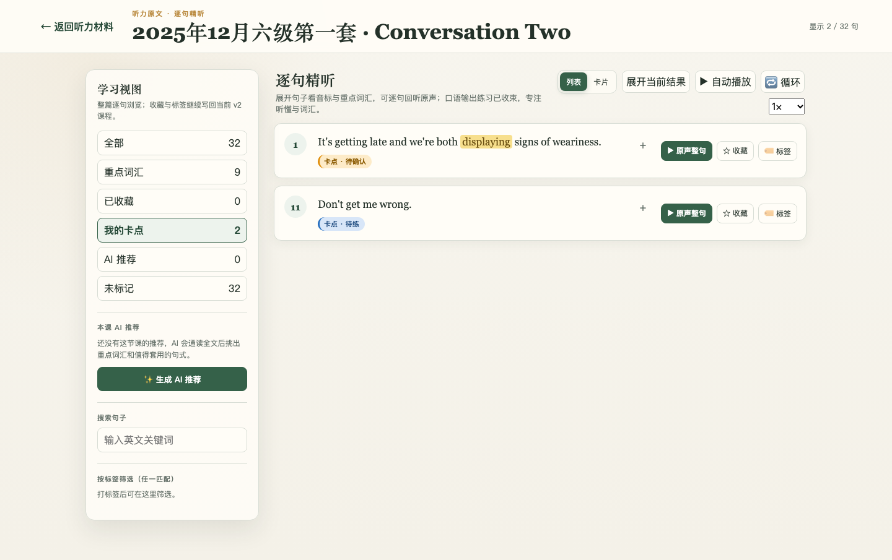
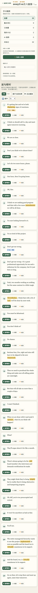
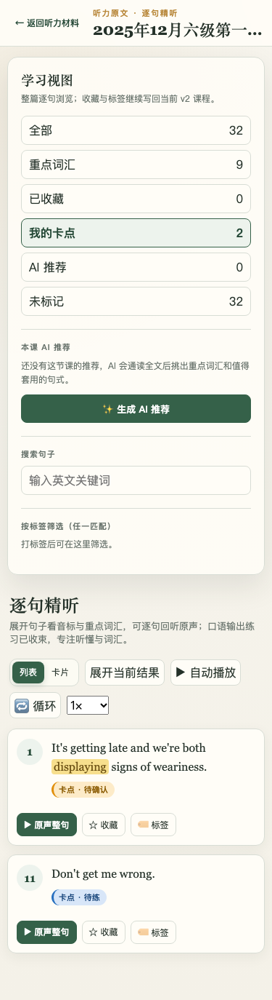
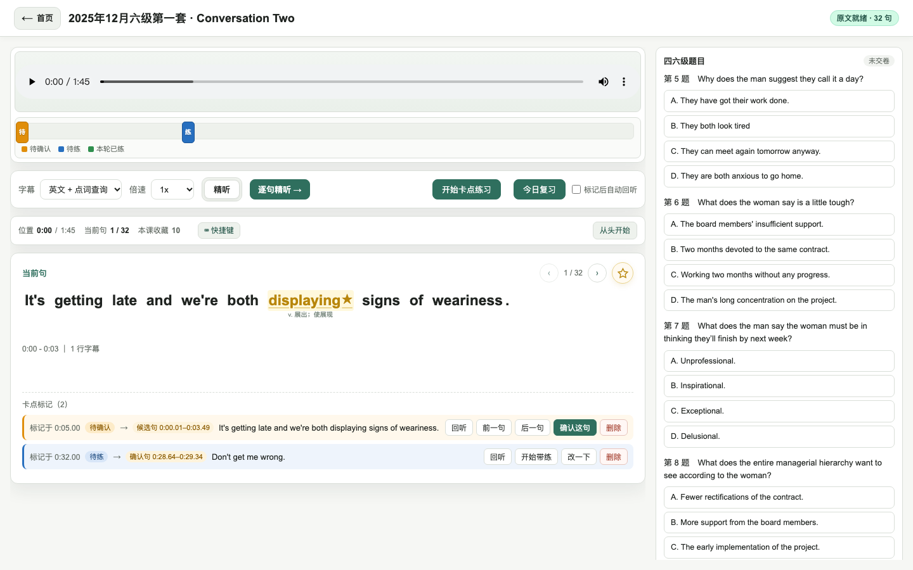
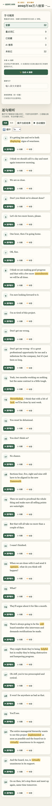
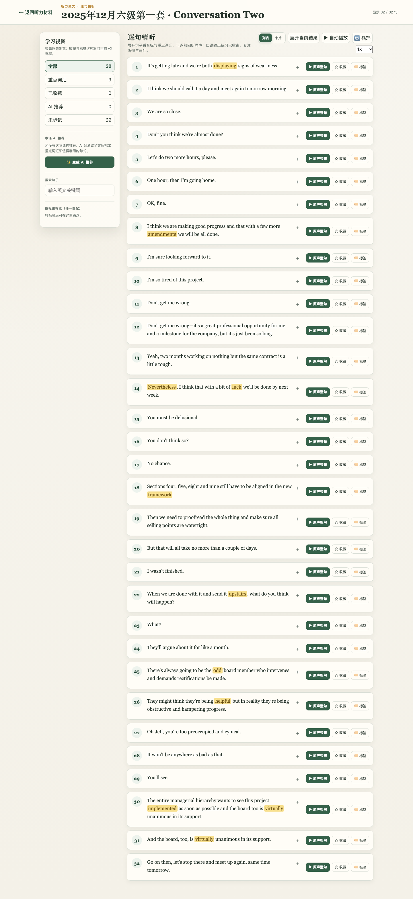

# 包 I · 逐句精听（卡点标记 + 我的卡点筛选）交付说明

- 包：I（P1 逐句精听）
- worktree：`/tmp/wt-drill-i`
- 分支：`codex/cet-drill-i`（基线 `c4a480d`）
- 端口：`5304`
- 独占改动文件：`frontend/templates/intensive.html`
- 证据目录：`docs/cet-base/卡点融合/evidence/I/`

## 1. 任务项完成情况

| 编号 | 要求 | 实现 | 状态 |
| --- | --- | --- | --- |
| I1 | 逐句精听页读 `/api/cet/marks`（按当前材料和本地 `cet.session.v1`）；卡点句加「卡点」标记，颜色和文字与工作区一致 | 页面加载时先 `GET /api/cet/materials/by-lesson/<lessonId>` 取当前 CET 材料的 `materialId`，再 `GET /api/cet/marks?materialId=<id>&listeningSessionId=<sid>`；按 `confirmedSentenceId`（优先）或 `suggestedSentenceId` 的 sentenceId 尾号匹配精听句，匹配不到再按时间重叠/`adjustedSeconds` 兜底；卡点句在句卡 `sentence-meta` 里显示「卡点 · 待确认 / 卡点 · 待练」徽标，配色与 `cet-listening.css` 的 `.cet-mark-badge-pending/ready` 逐色一致 | ✅ |
| I2 | 左侧筛选里加「我的卡点 N」，样式复用「重点词汇 / 已收藏」 | `mode-filters` 内新增 `<button class="mode-filter" data-filter="marks">我的卡点 <span id="count-marks">0</span></button>`；N 为有卡点的精听句数（同句多条时在徽标上显示 ×N）；点击后仅显示卡点句 | ✅ |
| I3 | 卡点模块关闭时，以上内容都不出现 | 服务端 ``（`cet_on and cet_features.cet_listening_agent`）控制筛选按钮与内联 CSS；JS `CET_MARKS_ON = CET_ON && cetFeature('cet_listening_agent')` 为 false 时**不发任何 `/api/cet/*` 请求**、不渲染徽标 | ✅ |

## 2. 关键实现说明

### 2.1 开关来源（单一来源，不新造第二套）

`intensive.html` 已有 `window.__CET_BOOT__ = { enabled, features, copy, lessonId }`（来自
`backend/webapp/cet_mode.py` 的 `template_context()`），本次直接复用：

- 模板服务端：`frontend/templates/intensive.html:8`
  ``
- 前端脚本：`frontend/templates/intensive.html:716`
  `const CET_MARKS_ON = CET_ON && cetFeature('cet_listening_agent');`

**为什么同时要求 `cet_on`**：`cet_mode.feature_enabled()` 在 `ELT_CET_MODE=0`（通用模式）会返回
全部功能为 true（保证通用模式原版可用），如果只判断 feature，通用模式会新增「我的卡点」筛选，
破坏「`ELT_CET_MODE=0` 行为与 `c4a480d` 一致」的回归。加上 `CET_ON` 后：通用模式不渲染任何卡点 UI，
CET 模式内再由 `ELT_CET_FEATURE_CET_LISTENING_AGENT=0` 单独关闭。

### 2.2 sessionId 生成规则（与 `cet-listening.js` 完全一致）

`frontend/templates/intensive.html:788-799`：

```js
let sessionId = '';
try { sessionId = localStorage.getItem(CET_MARKS_SESSION_KEY) || ''; } catch (_) {}
if (!sessionId) {
  sessionId = `cet-session-${Date.now().toString(36)}-${Math.random().toString(36).slice(2, 7)}`;
  try { localStorage.setItem(CET_MARKS_SESSION_KEY, sessionId); } catch (_) {}
}
return sessionId;
```

- 键名：`cet.session.v1`（`cet-listening.js:25` 的 `CFG.storageKey`）
- 缺省值格式：`cet-session-<Date.now().toString(36)>-<Math.random().toString(36).slice(2,7)>`
  （`cet-listening.js:71` 的 `uid('cet-session')`）
- 实测（新上下文、无预置 localStorage）：生成 `cet-session-mw6eami8-i7adf`，格式校验通过；
  用该 sessionId 通过 API 建标记后，精听页刷新出现 1 个「卡点 · 待确认」，工作区同一 localStorage
  读到同一个 sessionId 并显示「卡点标记（1）」——跨页共享验证通过（输出见 `evidence/I/verify_i_session.txt`）。

### 2.3 卡点句匹配逻辑（优先 sentenceId，其次时间重叠）

`frontend/templates/intensive.html:801-925` 的 `applyCetMarks()`：

1. **优先 sentenceId**：CET 的 `sentenceId` 形如 `v2-<lessonId>-<segmentIndex>`，精听句的
   `sentence.key` 来自同一份 `v2_subtitle_segments.idx`，两者尾号是同一套 segment index，直接
   `Number(sid.match(/-(\d+)$/)[1]) === Number(sentence.key)` 对齐。
2. **其次时间重叠**：用 `/api/cet/materials/by-lesson` 返回的 CET 句 `startSec/endSec` 与精听句
   `start_seconds/end_seconds` 求区间交集，取交集最大的句子。
3. **兜底**：用 mark 的 `adjustedSeconds`（后端吸附后的时间）或 `pressedAtSec` 落在哪一句。

标记取句优先级：`confirmedSentenceId || suggestedSentenceId`——已确认的卡点显示确认句，待确认的显示
后端吸附的候选句，和 `cet-listening.js` 的 `previewSentenceId()` 口径一致。

### 2.4 视觉口径（与工作区 `cet-listening.css` 对照）

| 状态 | 工作区 `.cet-mark` / `.cet-mark-badge` | 精听页内联 `.sentence-cet-mark` |
| --- | --- | --- |
| 待确认 pending | 边框 `#e08e0b`、底色 `#fff8ec`、徽标底 `#fdebc8` / 文字 `#8a5a00`、文案「待确认」 | 左边框 `#e08e0b`、底色 `#fdebc8` / 文字 `#8a5a00`、文案「卡点 · 待确认」 |
| 待练 ready | 边框 `#276fbf`、底色 `#eef4fc`、徽标底 `#d8e6f8` / 文字 `#17457a`、文案「待练」 | 左边框 `#276fbf`、底色 `#d8e6f8` / 文字 `#17457a`、文案「卡点 · 待练」 |
| 本轮已练 done | 边框 `#2f8f4e`、底色 `#eef8f1`、徽标底 `#d6eedd` / 文字 `#1c5c33`、文案「本轮已练」 | CSS 已同步该色板（`.sentence-cet-mark--done`），但 `/api/cet/marks` 不返回 practice 完成状态，本页暂不渲染该态（见 §7 风险项） |

内联样式块：`frontend/templates/intensive.html:341-365`（未改 `frontend/static/cet-listening.css`）。

### 2.5 「我的卡点」筛选

- 按钮：`frontend/templates/intensive.html:632-634`，沿用 `.mode-filter` 结构，与「重点词汇 / 已收藏」同款。
- 过滤：`frontend/templates/intensive.html:953`
  `if (activeMode === 'marks' && !cetMarksBySentenceKey.has(Number(sentence.key))) return false;`
- 计数：`frontend/templates/intensive.html:1238-1239`，`cetMarksBySentenceKey.size`（有卡点的句子数）。
- 空库时按钮仍显示「我的卡点 0」，与「已收藏 0」一致，不做死入口隐藏；只有课程本身不是 CET 材料
  （`by-lesson` 返回 404）时才隐藏该按钮（`setCetMarksAvailable()`，`:921-925`）。

## 3. 文件与行号

| 文件 | 行号 | 内容 |
| --- | --- | --- |
| `frontend/templates/intensive.html` | 8 | `cet_marks_on` 服务端开关（`cet_on and cet_features.cet_listening_agent`） |
| `frontend/templates/intensive.html` | 341-365 | 卡点徽标内联 CSS（三态色板，复制自 `cet-listening.css`） |
| `frontend/templates/intensive.html` | 624 | `#intensive-app` 上的 `data-cet-marks-on="1"`（仅开启时渲染，供 E2E 判断） |
| `frontend/templates/intensive.html` | 632-634 | 「我的卡点 N」筛选按钮 |
| `frontend/templates/intensive.html` | 716-717 | `CET_MARKS_ON` / `CET_MARKS_SESSION_KEY` |
| `frontend/templates/intensive.html` | 788-799 | `cetListeningSessionId()`（与 `cet-listening.js` 同规则） |
| `frontend/templates/intensive.html` | 801-925 | `cetMarkState` / 时间重叠匹配 / `applyCetMarks` / `loadCetMarks` / `setCetMarksAvailable` |
| `frontend/templates/intensive.html` | 953 | `visibleSentences()` 的 `marks` 过滤 |
| `frontend/templates/intensive.html` | 1042-1047 | `renderSentenceCard()` 渲染卡点徽标（`sentence-meta`，`:1075` 插入） |
| `frontend/templates/intensive.html` | 1238-1239 | 「我的卡点」计数 |
| `frontend/templates/intensive.html` | 2594-2618 | `loadIntensiveStudy()` 并行加载卡点（关闭时 `Promise.resolve(null)`，不发请求） |

## 4. 测试命令与输出原文

### 4.1 pytest（只设 `ELT_CONFIG_DIR`，不设 `ELT_USER_DB`）

命令：

```bash
cd /tmp/wt-drill-i
ELT_CONFIG_DIR=$(mktemp -d) .venv/bin/python -m pytest \
  tests/test_v2_intensive_routes.py tests/test_cet_base_workspace.py \
  tests/test_cet_base_mode.py tests/test_cet_listening_ui.py \
  tests/test_cet_marks_fix_a_frontend.py tests/test_cet_marks_fix_b_verify.py \
  tests/test_cet_fix21_a_frontend.py tests/test_cet_fix2_p1_workspace.py -q
```

输出原文（保存于 `evidence/I/pytest-i.txt`）：

```text
..............sssssssssssssssssssssssss................................. [ 34%]
ssssssssssssssssssssssssssssssssssss.............................sss..ss [ 68%]
..sss....ssssss................................................        [100%]
132 passed, 77 skipped in 1.98s
```

### 4.2 包 I 功能浏览器验证（真实服务 + 真实点击，1440/375）

命令：

```bash
cd /tmp/wt-drill-i
.venv/bin/python docs/cet-base/卡点融合/evidence/I/verify_i.py
```

输出原文（14/14 全通过；完整 JSON 见 `evidence/I/verify_i_result.json`）：

```text
[PASS] I2 筛选按钮存在且名称正确: 我的卡点
2
[PASS] I2 筛选样式复用 .mode-filter: True
[PASS] I1 卡点句出现「卡点」标记: [{"key": 0, "text": "卡点 · 待确认", "backgroundColor": "rgb(253, 235, 200)", "color": "rgb(138, 90, 0)", "borderLeftColor": "rgb(224, 142, 11)", ...}, {"key": 10, "text": "卡点 · 待练", "backgroundColor": "rgb(216, 230, 248)", "color": "rgb(23, 69, 122)", "borderLeftColor": "rgb(39, 111, 191)", ...}]
[PASS] I1 待确认态颜色/文案与工作区一致: ...
[PASS] I1 待练态颜色/文案与工作区一致: ...
[PASS] I2 点击「我的卡点」只显示卡点句: [0, 10]
[PASS] I2 我的卡点计数: 2
[PASS] I2 结果统计同步: 显示 2 / 32 句
[PASS] 真实媒体播放（原声整句）: {"currentTime": 0.674, "paused": false, "playbackRate": 1, "src": "cet/cet6-202512-conv2.mp3", "duration": 105.49}
[PASS] 真实媒体倍速（1.25×）: {"playbackRate": 1.25, "paused": false, "currentTime": 0.679}
[PASS] 页面无 JS 错误: []
[PASS] 375 宽度筛选按钮可见: 我的卡点
2
[PASS] 375 宽度卡点筛选结果: 2
[PASS] 工作区卡点面板可对照（待确认/待练）: 卡点标记（2）...
{"passed": 14, "total": 14, "allPass": true}
```

### 4.3 I3 关闭态验证（`ELT_CET_FEATURE_CET_LISTENING_AGENT=0`）

命令：

```bash
# 服务以 ELT_CET_FEATURE_CET_LISTENING_AGENT=0 启动
.venv/bin/python docs/cet-base/卡点融合/evidence/I/verify_i_off.py
```

输出原文（8/8 全通过；完整 JSON 见 `evidence/I/verify_i_off_result.json`）：

```text
[PASS] 1440 无「我的卡点」筛选: 0
[PASS] 1440 无卡点标记: 0
[PASS] 1440 不发 /api/cet/* 请求: []
[PASS] 1440 精听正文正常: 32
[PASS] 375 无「我的卡点」筛选: 0
[PASS] 375 无卡点标记: 0
[PASS] 375 不发 /api/cet/* 请求: []
[PASS] 375 精听正文正常: 32
{"passed": 8, "total": 8, "allPass": true}
```

### 4.4 通用模式回归（`ELT_CET_MODE=0` 与基线 `c4a480d` 像素比对）

命令：

```bash
# 本分支 5304、基线 worktree 5319，均以 ELT_CET_MODE=0 启动
.venv/bin/python docs/cet-base/卡点融合/evidence/I/verify_i_generic.py
```

输出原文（2/2 全通过；完整 JSON 见 `evidence/I/verify_i_generic_result.json`）：

```text
[PASS] 通用模式无卡点 UI / 无 CET 请求（本分支）: {"title": "逐句精读 - EchoLingo", "marksFilter": 0, "marksChips": 0, "cetRequests": [], "cards": 32, "heading": "句子精学工坊"}
[PASS] 通用模式与基线 c4a480d 像素级一致: {'mineSize': (1440, 3137), 'baselineSize': (1440, 3137), 'diffBBox': None}
{"passed": 2, "total": 2, "allPass": true, ...}
```

### 4.5 卡点模块关闭时与基线 `c4a480d` 的像素比对

`evidence/I/verify_i_feature_off_regression.json`：

```json
{"mine": {"title": "逐句精听 - EchoLingo", "filter": 0, "chips": 0, "cetreqs": [], "cards": 32},
 "baseline": {"title": "逐句精听 - EchoLingo", "filter": 0, "chips": 0, "cetreqs": [], "cards": 32},
 "pixel": {"mineSize": [1440, 3137], "baselineSize": [1440, 3137], "diffBBox": null},
 "pass": true}
```

即：`ELT_CET_FEATURE_CET_LISTENING_AGENT=0` 下，本分支精听页与基线 c4a480d 逐像素一致。

### 4.6 渲染后 JS 语法检查

```bash
node --check /tmp/cet-i-script-*.js   # 从渲染后 HTML 抽出的全部内联脚本
# OK /tmp/cet-i-script-0.js ... OK /tmp/cet-i-script-4.js
```

### 4.7 匹配兜底验证（时间重叠 / adjustedSeconds）

在真实页面上下文里注入「sentenceId 尾号不在精听句」和「只有时间」的模拟 mark，验证兜底逻辑
（输出见 `evidence/I/verify_i_matching.txt`）：

```text
range-fallback: [{'key': '1', 'text': '卡点 · 待确认'}]     # 按 CET 句 3.6–7.0s 与精听句区间重叠命中 key=1
time-fallback: [{'key': '10', 'text': '卡点 · 待确认'}]    # 按 adjustedSeconds=28.8s 命中 key=10
```

## 5. 截图（1440 / 375）

| 截图 | 说明 |
| --- | --- |
|  | 1440 宽：全部句子，两处卡点徽标（待确认 / 待练）与「我的卡点 2」筛选 |
|  | 1440 宽：点击「我的卡点」后只剩 2 句卡点句，「显示 2 / 32 句」 |
|  | 375 宽：筛选与卡点徽标完整可见（全页） |
|  | 375 宽：卡点筛选结果 |
|  | 工作区卡点列表（颜色/文案对照来源：待确认 / 待练） |
|  | 1440 宽：`CET_LISTENING_AGENT=0` 关闭态，无筛选、无标记 |
|  | 375 宽：关闭态 |
|  | 通用模式（与 09 基线截图逐像素一致） |
|  | 基线 c4a480d 通用模式截图（对照组） |
|  | 本分支关闭态（与 11 基线截图逐像素一致） |
|  | 基线 c4a480d 关闭态截图（对照组） |

## 6. 缓存串

本次只改 `frontend/templates/intensive.html` 的内联 `<style>` 与内联 `<script>`：

- 该页面路由 `/workspace/{lesson_id}/intensive` 的响应头是
  `Cache-Control: no-store, max-age=0`（`backend/webapp/fastapi_routes/pages.py:135-139`），
  模板本身不进缓存；
- 模板内两个外部脚本 `elt_credits.js?v=20260809-1`、`natural-tts.js?v=20260809-1` 本次**未改动**，
  旧串 = 新串 = `20260809-1`；
- 未改 `frontend/static/cet-listening.js/.css`（K 包负责），未改 `cet-workspace.css` / `cet-player.js`（W 包负责）。

**结论：纯内联改动，无外部缓存串需要升，也无新旧串差异。**

## 7. 未完成项 / 风险

1. **「本轮已练」三态未在精听页展示**：`/api/cet/marks` 只返回 `inPractice: bool`，不返回 practice 的
   `status`，无法可靠判断「本轮已练」；本页只显示「待确认 / 待练」两态（与工作区列表中用户实际会看到的
   两态文案一致）。若 K 包后续在 marks 响应里补充 practice 状态，可在 `cetMarkState()` 内直接扩展。
2. **只读当前 localStorage 会话**：与工作区一致，换浏览器/清站点数据后看不到旧会话的标记（数据仍在库中）。
3. **非 CET 材料/无 by-lesson 映射**：`/api/cet/materials/by-lesson` 404 时隐藏「我的卡点」按钮，
   不显示空壳入口。
4. **首次加载多一个串行请求链**：`by-lesson` → `marks` 与精读文档并行执行，正常本地环境无可感知延迟；
   若后端 marks 接口异常，`loadCetMarks()` 返回 null，精听主流程不受影响。
5. **未做跨标签页实时刷新**：工作区新建卡点后，需要重新进入/刷新精听页才能看到；本页不做轮询。
   如主代理认为需要，可加 `pageshow`/`visibilitychange` 重新拉取。
6. **全量 pytest 未跑完**：与其它 4 个并行包同时跑全量 suite 时资源竞争，长时间停在 22%（不是本包代码失败）；
   本包相关的 8 个测试文件已全量通过（132 passed / 77 skipped，见 §4.1）。主代理总验收时可在干净环境重跑全量。

## 8. 需要 K / W 配合的点

- **K（`cet-listening.js/.css`）**：本包依赖 `cet.session.v1` 键名与 `/api/cet/marks` 返回字段
  (`markId/suggestedSentenceId/confirmedSentenceId/adjustedSeconds/pressedAtSec`)；请 K 保持这两项不变。
  若 K 把会话键或字段改名，请同步告知。本包未改 K 的文件。
- **W（`workspace.html`）**：本包未改 W 的文件。如果 W 在卡点列表/工作区增加「去精听页看这句」入口，
  可直接链接 `/workspace/<lessonId>/intensive?sentence_key=<mark 的 CET sentenceId 尾号>`——
  精听页现有 `sentence_key` 参数会把对应句高亮并滚动到视野。
- **主代理**：本包只改 `frontend/templates/intensive.html`，与 K/W 的文件无写冲突；合并时无需解决冲突。
